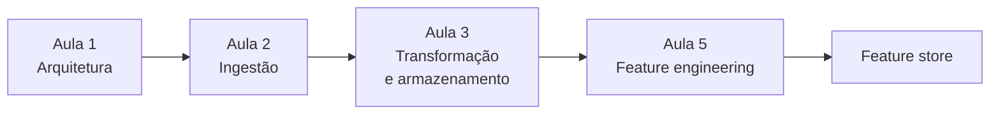

<p align="center">
  <a href="#percurso">Percurso</a>
  &nbsp;·&nbsp;
  <a href="#exercicio-5">Exercício 5</a>
  &nbsp;·&nbsp;
  <a href="#como-rodar">Como rodar</a>
  &nbsp;·&nbsp;
  <a href="#mapa-do-repositorio">Mapa</a>
</p>

<h1 align="center">Pipeline de Dados</h1>

<p align="center">
  Repositório da disciplina na pós em Engenharia de IA e MLOps.<br>
  Material de aula, exercícios e o relatório de feature engineering.
</p>

<p align="center">
  
  
  
  
</p>

O percurso sai da arquitetura do pipeline, passa por ingestão e armazenamento, e chega na construção das variáveis que um modelo consegue usar. O [Exercício 5](#exercicio-5) é a entrega fechada: seis questões, scripts reprodutíveis e o [relatório em PDF](Exercicio_5/FeatureEngineering_FeatureStore_LucasZegrineDuarte.pdf).



## Percurso

Clique numa aula para abrir o material e o estado da entrega. A aula 4 ainda não está nesta pasta.

| Aula | Tema | Material | Entrega |
| --- | --- | --- | --- |
| 1 | Arquiteturas e fundamentos | [slides](<Canvas/Aula 1 - Arquiteturas e fundamentos de pipelines de dados/Apresentação/Aula 1 - Arquiteturas e fundamentos de pipelines de dados.pdf>) · [enunciado](<Canvas/Aula 1 - Arquiteturas e fundamentos de pipelines de dados/Exercícios/Exercício 1 - Arquiteturas e fundamentos de pipelines de dados.docx>) | pasta criada |
| 2 | Ingestão e integração | [slides](<Canvas/Aula 2 - Ingestão e integração de dados/Apresentação/Aula 2 - Ingestão e integração de dados.pdf>) | pasta criada |
| 3 | Transformação e armazenamento | [slides](<Canvas/Aula 3 - Transformação e armazenamento de dados/Apresentação/Aula 3 - Transformação e armazenamento de dados.pdf>) | pasta criada |
| 4 | — | — | ainda não publicada |
| 5 | Feature engineering e feature stores | [slides](<Canvas/Aula 5 - Feature Engineering e Feature Stores/Apresentação/Aula 5 - Feature Engineering e Feature Stores.pdf>) · [enunciado](<Canvas/Aula 5 - Feature Engineering e Feature Stores/Exercícios/Exercício 5 - Feature engineering e feature store.docx>) · [base](<Canvas/Aula 5 - Feature Engineering e Feature Stores/Material de apoio/Bases de dados/transacoes_bancarias.csv>) | [concluído](#exercicio-5) |

<details>
<summary><b>Aula 1 · Arquiteturas e fundamentos de pipelines de dados</b></summary>

<br>

O ponto de partida: o que compõe um pipeline, de onde o dado entra e como as etapas se encadeiam antes de qualquer modelo.

- [Apresentação](<Canvas/Aula 1 - Arquiteturas e fundamentos de pipelines de dados/Apresentação/Aula 1 - Arquiteturas e fundamentos de pipelines de dados.pdf>)
- [Enunciado](<Canvas/Aula 1 - Arquiteturas e fundamentos de pipelines de dados/Exercícios/Exercício 1 - Arquiteturas e fundamentos de pipelines de dados.docx>)
- A resolução fica em `Exercicio_1/` quando for commitada.

</details>

<details>
<summary><b>Aula 2 · Ingestão e integração de dados</b></summary>

<br>

Como o dado chega e como fontes diferentes passam a conviver no mesmo fluxo.

- [Apresentação](<Canvas/Aula 2 - Ingestão e integração de dados/Apresentação/Aula 2 - Ingestão e integração de dados.pdf>)
- A resolução fica em `Exercicio_2/`.

</details>

<details>
<summary><b>Aula 3 · Transformação e armazenamento de dados</b></summary>

<br>

A etapa em que o dado bruto vira um conjunto consultável, com forma e lugar definidos.

- [Apresentação](<Canvas/Aula 3 - Transformação e armazenamento de dados/Apresentação/Aula 3 - Transformação e armazenamento de dados.pdf>)
- A resolução fica em `Exercicio_3/`.

</details>

<details>
<summary><b>Aula 5 · Feature engineering e feature stores</b></summary>

<br>

Criar, reescalar, selecionar e publicar variáveis para o modelo. A entrega correspondente está na seção seguinte.

- [Apresentação](<Canvas/Aula 5 - Feature Engineering e Feature Stores/Apresentação/Aula 5 - Feature Engineering e Feature Stores.pdf>)
- [Enunciado](<Canvas/Aula 5 - Feature Engineering e Feature Stores/Exercícios/Exercício 5 - Feature engineering e feature store.docx>)
- [Base de transações](<Canvas/Aula 5 - Feature Engineering e Feature Stores/Material de apoio/Bases de dados/transacoes_bancarias.csv>)
- Cópia de trabalho da aula em [`Exercicio_5/material/`](Exercicio_5/material)

</details>

## Exercício 5

Feature engineering aplicado a tabelas pequenas e a uma base de 1.000 transações bancárias. Cada questão tem um script em `Exercicio_5/scripts/` e o CSV correspondente em `Exercicio_5/scripts/results/`.

[Relatório PDF](Exercicio_5/FeatureEngineering_FeatureStore_LucasZegrineDuarte.pdf) · [LaTeX](Exercicio_5/latex/Paper.tex) · [Enunciado](Exercicio_5/Enunciado.docx)

<details>
<summary><b>Questão 1 · One-hot encoding</b> &nbsp;·&nbsp; <code>q1.py</code></summary>

<br>

A coluna `Produto` (Eletrônicos, Roupas, Eletrodomésticos, Livros) vira uma coluna binária por categoria, com `pandas.get_dummies`.

[Script](Exercicio_5/scripts/q1.py) · [resultado](Exercicio_5/scripts/results/q1.csv)

</details>

<details>
<summary><b>Questão 2 · Seleção de features</b> &nbsp;·&nbsp; <code>q2.py</code></summary>

<br>

`SelectKBest` com `f_regression` escolhe as duas variáveis mais associadas ao preço do imóvel. Tamanho e quartos entram. As dummies de localização ficam de fora. O maior F é o de Tamanho (54,56).

[Script](Exercicio_5/scripts/q2.py) · [ranking](Exercicio_5/scripts/results/q2_feature_rank.csv) · [seleção](Exercicio_5/scripts/results/q2_feature_selection.csv)

</details>

<details>
<summary><b>Questão 3 · Min-Max e Z-score</b> &nbsp;·&nbsp; <code>q3.py</code></summary>

<br>

Notas de Matemática e Português, em escalas diferentes, passam por `MinMaxScaler` e `StandardScaler`.

| Variável | Mínimo | Máximo | Média | Desvio |
| --- | ---: | ---: | ---: | ---: |
| Matemática | 78 | 96 | 87,8 | 6,14 |
| Português | 5 | 9 | 7,0 | 1,41 |

No Min-Max as duas ficam em \[0, 1\]. No Z-score, média 0 e desvio 1.

[Script](Exercicio_5/scripts/q3.py) · [parâmetros](Exercicio_5/scripts/results/q3_parametros.csv) · [escalas](Exercicio_5/scripts/results/q3_escalas.csv)

</details>

<details>
<summary><b>Questão 4 · Features polinomiais</b> &nbsp;·&nbsp; <code>q4.py</code></summary>

<br>

`PolynomialFeatures` de grau 2 gera quadrados e produtos entre notas e satisfação. Na primeira linha, 8 × 4 = 32 e 7 × 4 = 28.

[Script](Exercicio_5/scripts/q4.py) · [resultado](Exercicio_5/scripts/results/q4_polynomial.csv)

</details>

<details>
<summary><b>Questão 5 · Interação</b> &nbsp;·&nbsp; <code>q5.py</code></summary>

<br>

A feature `Idade × Produtos_Comprados` vale 140, 315, 315, 66 e 186. A correlação de Pearson entre as duas colunas originais é **0,729**.

[Script](Exercicio_5/scripts/q5.py) · [interação](Exercicio_5/scripts/results/q5_interacao.csv) · [correlação](Exercicio_5/scripts/results/q5_correlacao.csv)

</details>

<details>
<summary><b>Questão 6 · Transações bancárias</b> &nbsp;·&nbsp; <code>q6.py</code></summary>

<br>

Base [`transacoes_bancarias.csv`](Exercicio_5/data/transacoes_bancarias.csv): data, produto, valor, cliente, idade, sexo e estado. Mil compras.

- **Sexo e produto.** Qui-quadrado 12,13, 19 graus de liberdade, p = 0,880, V de Cramér **0,110**. A associação é fraca.
- **Dia da semana.** Sábado concentra 163 compras (16,3%). Segunda-feira tem o menor volume, 110.
- **Valor por estado.** Min-Max dentro de cada UF. Nos 27 estados o valor normalizado vai de 0 a 1.

[Script](Exercicio_5/scripts/q6.py) · [sexo × produto](Exercicio_5/scripts/results/q6_sexo_produto.csv) · [dia](Exercicio_5/scripts/results/q6_dia_semana.csv) · [valor normalizado](Exercicio_5/scripts/results/q6_valor_norm.csv)

</details>

## Como rodar

Na pasta `Exercicio_5`:

```bash
python3 -m venv .venv
source .venv/bin/activate
pip install -r requirements.txt
```

Os scripts esperam ser executados de dentro de `scripts/`. Cada um grava o CSV em `scripts/results/`.

```bash
cd scripts
python q1.py
python q2.py
python q3.py
python q4.py
python q5.py
python q6.py
```

Dependências, em [`requirements.txt`](Exercicio_5/requirements.txt): `pandas`, `scikit-learn` e `scipy`. O ambiente virtual não entra no Git.

O relatório é compilado a partir de `Exercicio_5/latex/` com `latexmk` ou `pdflatex`. O PDF já gerado está em [`FeatureEngineering_FeatureStore_LucasZegrineDuarte.pdf`](Exercicio_5/FeatureEngineering_FeatureStore_LucasZegrineDuarte.pdf).

## Mapa do repositório

```text
.
├── Canvas/                          aulas, enunciados e bases
│   ├── Aula 1 - Arquiteturas e fundamentos de pipelines de dados
│   ├── Aula 2 - Ingestão e integração de dados
│   ├── Aula 3 - Transformação e armazenamento de dados
│   └── Aula 5 - Feature Engineering e Feature Stores
├── Exercicio_1/ … Exercicio_4/      reservadas para as entregas
└── Exercicio_5/
    ├── scripts/q1.py … q6.py
    ├── scripts/results/             CSVs gerados
    ├── data/transacoes_bancarias.csv
    ├── latex/                       fonte do relatório
    ├── material/                    cópia da aula 5
    └── FeatureEngineering_FeatureStore_LucasZegrineDuarte.pdf
```

<p align="center">
  Lucas Zegrine Duarte
</p>
